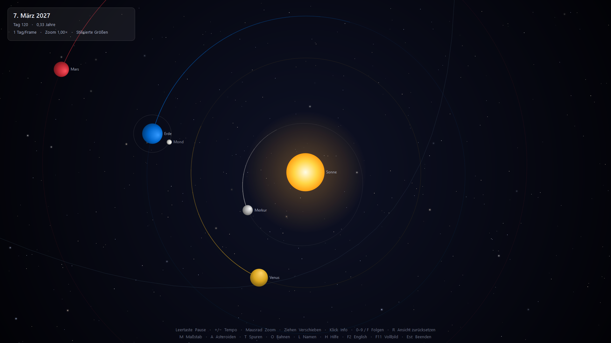
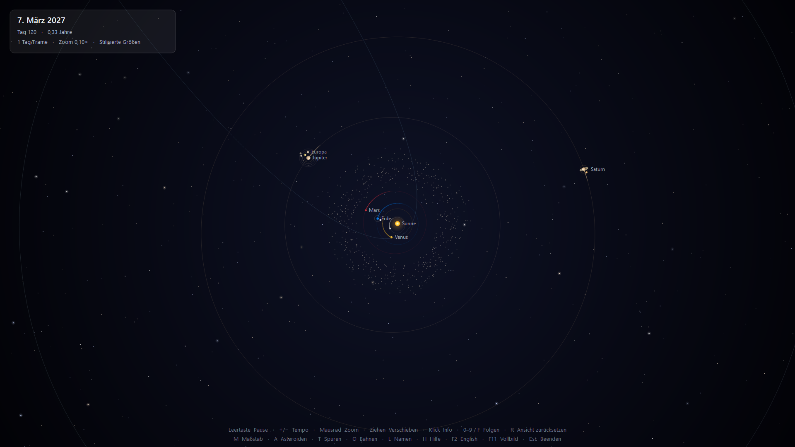
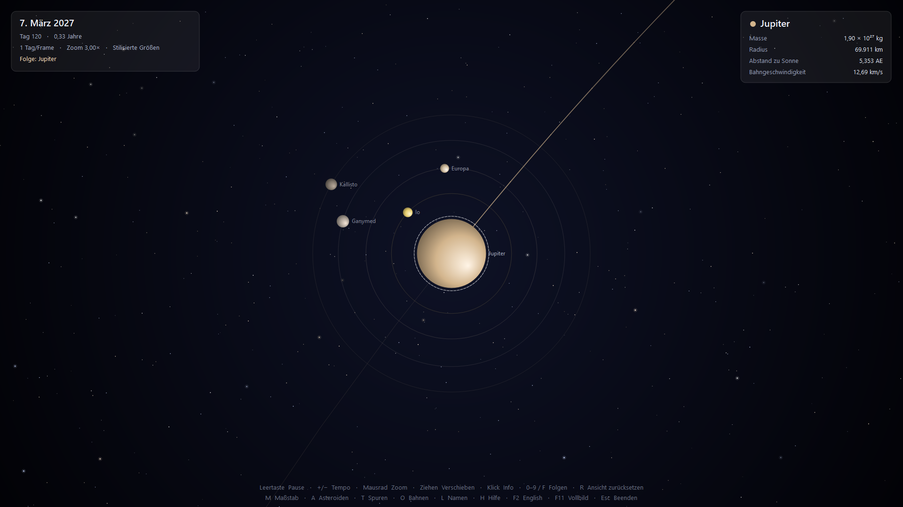
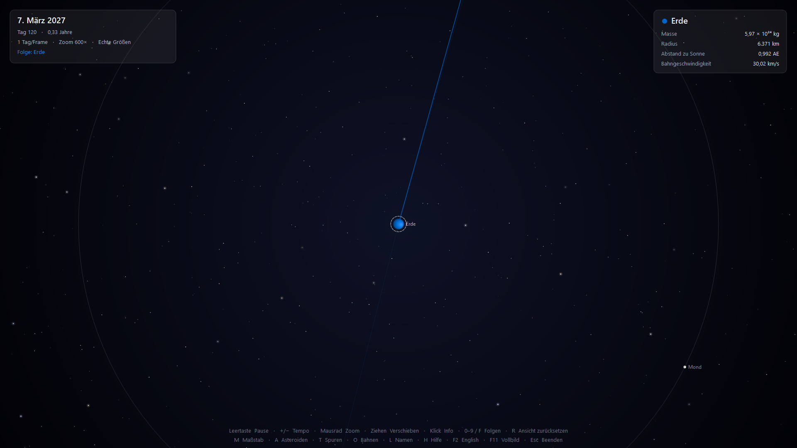

# Solar System Simulation



A real-time **solar system simulation** written in **Python** with **PyQt5** and **numpy**.
It starts with the planets where they actually are **today** and moves them with Newtonian gravity.
The interface is available in **German and English** (`F2`).

| Outer solar system & asteroid belt | Jupiter and its moons | True scale: Earth and Moon |
|---|---|---|
|  |  |  |

## 🪐 Features

- **Real positions for today's date**: planets and Pluto from the JPL Keplerian elements ([Standish, valid 1800–2050](https://ssd.jpl.nasa.gov/planets/approx_pos.html)), Halley's Comet from its orbital elements
- **3D N-body simulation** with a symplectic Velocity-Verlet integrator (6-hour steps; energy stays stable over centuries), vectorized with numpy
- **7 major moons**: Moon, Io, Europa, Ganymede, Callisto, Titan and Triton (retrograde)
- **Asteroid belt** of 500 bodies with Kirkwood gaps, disturbed by Jupiter and Saturn
- **Stylized or true-scale sizes** (`M`). Zoom from the whole system down to the Earth–Moon system
- **Real orbit ellipses**, fading trails, labels, glowing Sun, shaded planets, Saturn's rings, star field
- **Zoom to cursor**, **pan** by dragging, **follow** any body, **click** for an info panel
- **Pause and speed control**: from 1 minute to 64 days per frame (slow speeds for watching the moons), current date in the HUD

## 🎮 Controls

| Key / Action  | Function |
|---------------|----------|
| `Space`       | Pause / resume |
| `+` / `-`     | Faster / slower (1 minute … 64 days per frame) |
| `Mouse wheel` | Zoom at the cursor |
| `Drag`        | Pan the view |
| `Click`       | Show info for a body (click empty space to close) |
| `0`–`9`       | Follow Sun / Mercury … Pluto |
| `F`           | Follow the selected body (e.g. a moon or Halley) |
| `R`           | Reset view (zoom, pan, follow) |
| `M`           | Stylized ↔ true-scale sizes |
| `A`           | Toggle asteroid belt |
| `T` / `O` / `L` | Toggle trails / orbits / labels |
| `H`           | Toggle help bar |
| `F2`          | Deutsch ↔ English |
| `F11`         | Fullscreen |
| `Esc`         | Quit |

## 🚀 Installation & Run

Requires Python 3.10+. PyQt5 and numpy are installed automatically.

```bash
python -m venv .venv
.venv\Scripts\activate          # Linux/macOS: source .venv/bin/activate
pip install -e .
python -m solarsystem           # or simply: solarsystem
```

## 🔭 Accuracy notes

- Planet start positions follow JPL's approximate elements (arc-minute accuracy). After that, the N-body simulation takes over.
- Moons move on circular orbits around their planet ("on rails"), because Io's 1.8-day orbit would need minute-sized time steps. The Moon's start angle is real. The start angles of the other moons are approximations.
- Asteroids are massless test particles. They feel the Sun, Jupiter and Saturn but don't pull on anything.

## 🧪 Development

```bash
pip install -e .[dev]
pytest                # run tests
ruff check .          # lint
ruff format .         # format
```

## 🗂️ Structure

```
├── pyproject.toml            # metadata, dependencies, tool config
├── LICENSE                   # MIT
├── docs/                     # screenshots
├── src/solarsystem/
│   ├── __main__.py           # entry point for `python -m solarsystem`
│   ├── app.py                # main window, timer, keyboard/mouse input
│   ├── renderer.py           # all drawing
│   ├── camera.py             # zoom, pan, follow, sizes, screen layout   (no Qt)
│   ├── physics.py            # bodies, gravity, Verlet integrator (numpy) (no Qt)
│   ├── orbits.py             # Kepler elements, orbit ellipses, dates     (no Qt)
│   ├── bodies.py             # planets, moons, Halley, asteroid belt      (no Qt)
│   ├── trails.py             # orbit trail history                        (no Qt)
│   ├── playback.py           # pause and speed                            (no Qt)
│   ├── i18n.py               # German / English texts and formats         (no Qt)
│   ├── config.py             # constants
│   └── assets/icon.png
└── tests/
```

## 📄 License

[MIT](LICENSE) © 2026 Willi Müller
